<div align="center">


# AhaTools

轻量的 macOS 菜单栏工具箱：一个热键搜索一切，鼠标旁边处理选中的文字和文件，菜单栏看网速和系统状态。

[](https://github.com/PYPARA/Aha-tools/releases/latest)


[](LICENSE)

</div>

<p align="center">
  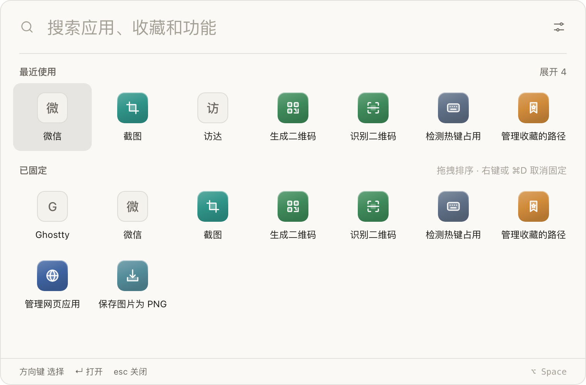
</p>

## 功能

**搜索面板（默认 ⌥Space）**

- 搜应用、收藏的文件夹和路径、所有插件功能；支持中文名、全拼和首字母（`wx` → 微信）
- 首页显示最近使用和已固定，⌘1–9 直接打开，拖动排序，右键固定或删除
- 输入 `fy hello` 这类「关键词 + 文字」直接带入功能；粘贴图片、拖入文件会自动列出能处理它的功能
- 跟随鼠标所在的屏幕弹出；可设置再次打开时回到上次的页面还是搜索

**超级面板（默认 ⌥⇧Space，也可长按鼠标右键）**

<p>
  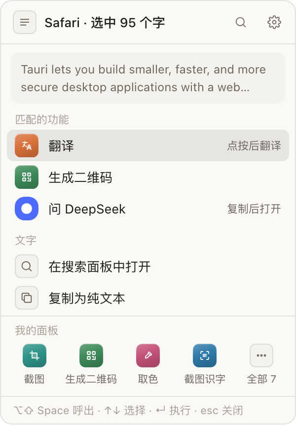
  &nbsp;
  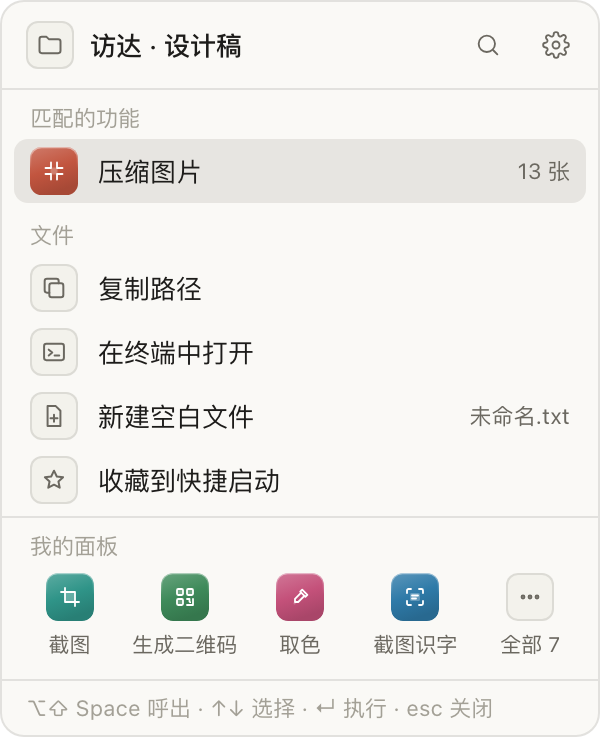
</p>

- 在鼠标旁边弹出，读取当前选中的文字，或访达里选中的文件 / 文件夹
- 按各插件声明的匹配规则列出能用的功能：文字 → 翻译、生成二维码、问网页应用；图片文件夹 → 压缩图片；单张图片 → 识别二维码
- 自带复制路径、在终端中打开、新建文件、收藏等操作，也能加自己的命令（如 `code {path}`）
- 什么都没选时显示「我的面板」：在搜索结果上右键「固定到超级面板」即可加入
- 不会自动翻译，点了才发请求

**菜单栏**

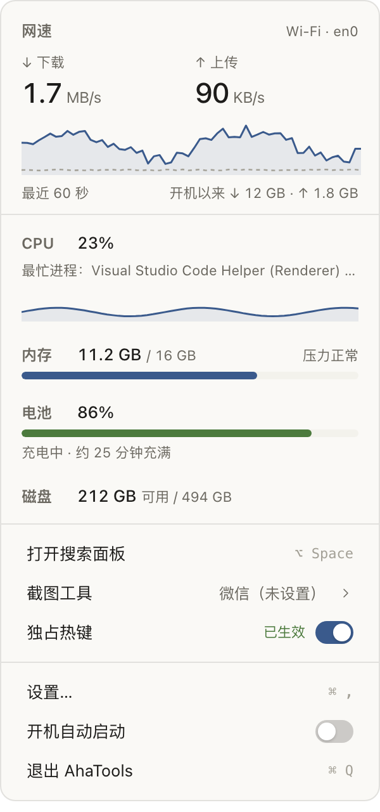

- 双行显示实时上传 / 下载网速，可加 CPU、内存
- 点开是网速曲线、CPU、内存、电池和磁盘
- 快速切换截图工具、独占热键和开机启动

<br clear="right">

**内置插件**

<table>
<tr>
<td width="50%" valign="top">
<b>翻译</b><br>
<sub>接自己的大模型服务（OpenAI Chat / Responses、Anthropic Messages），流式翻译、润色、解释；单个单词给出音标、释义和例句</sub><br><br>
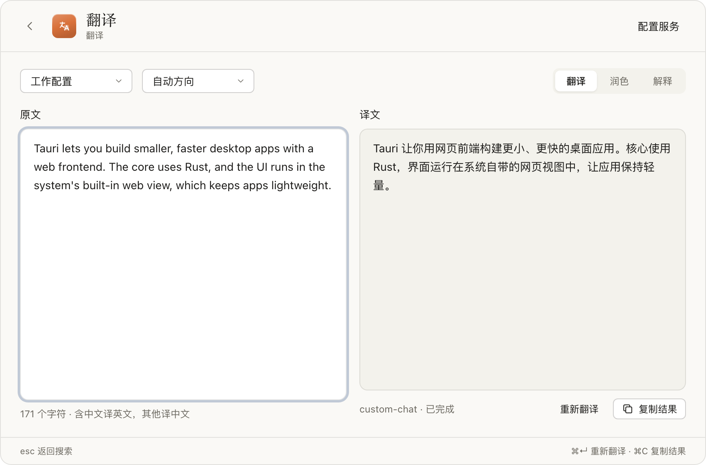
</td>
<td width="50%" valign="top">
<b>二维码</b><br>
<sub>边输入边生成，复制图片或保存 PNG；识别剪贴板、拖入图片里的二维码</sub><br><br>
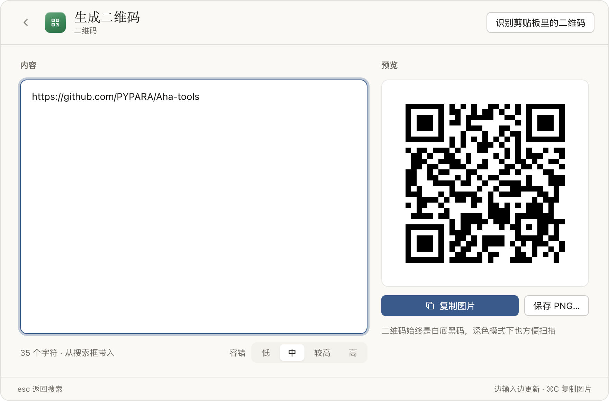
</td>
</tr>
<tr>
<td width="50%" valign="top">
<b>图片压缩</b><br>
<sub>PNG / JPEG / WebP 在本机批量压缩，结果先放临时目录，原图不动，再选择覆盖、另存或复制</sub><br><br>
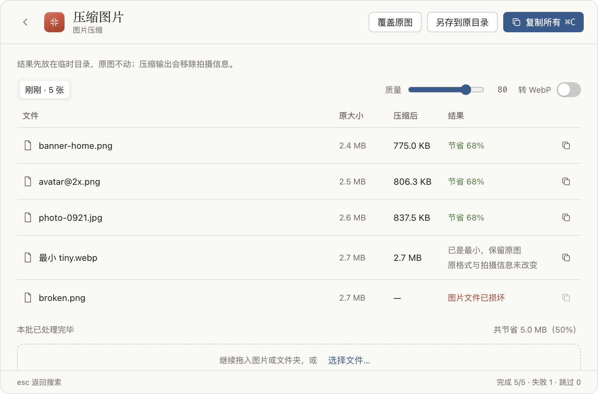
</td>
<td width="50%" valign="top">
<b>截图识字</b><br>
<sub>框选屏幕区域，用系统 Vision 在本机识别中英文，结果自动复制</sub><br><br>
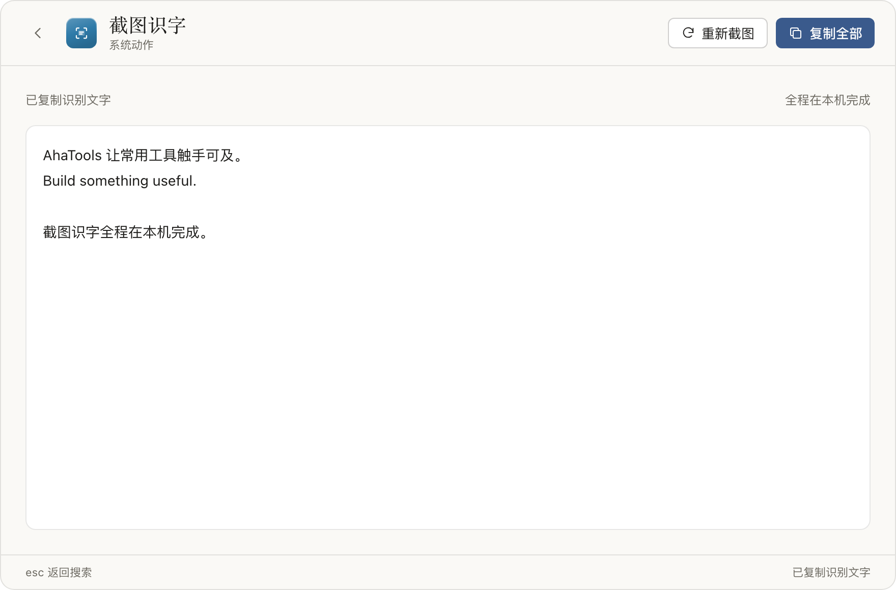
</td>
</tr>
<tr>
<td width="50%" valign="top">
<b>hosts 切换</b><br>
<sub>多套方案合并写入，管理员授权后生效并刷新 DNS，随时恢复原始 hosts</sub><br><br>
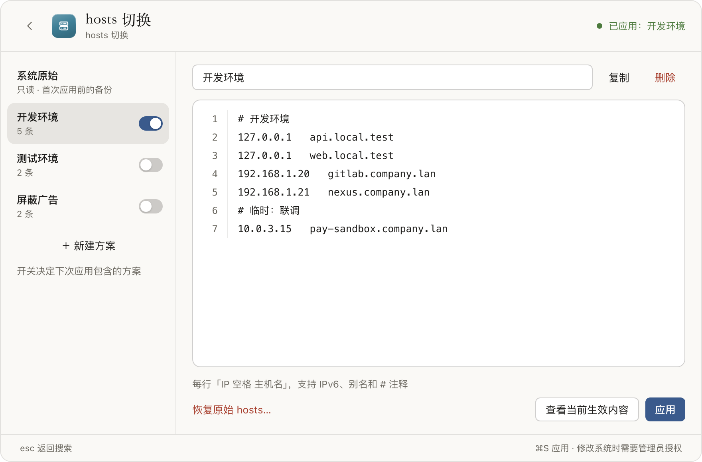
</td>
<td width="50%" valign="top">
<b>热键检测</b><br>
<sub>查看常用组合键被谁占用；独占热键让 uTools 等不再同时弹出</sub><br><br>
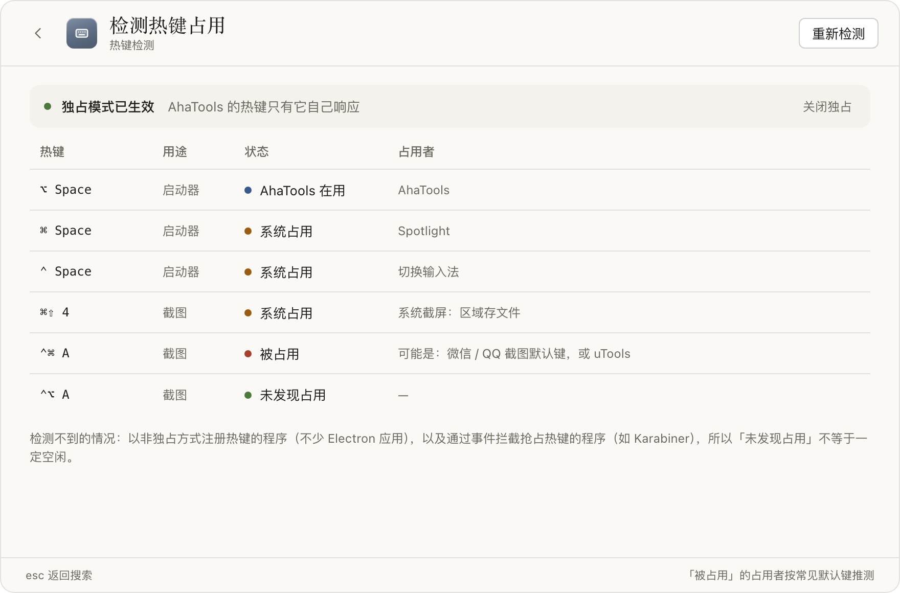
</td>
</tr>
<tr>
<td width="50%" valign="top">
<b>网页应用</b><br>
<sub>把常用网站放进独立窗口，登录和对话一直保留，可设热键（内置 DeepSeek）</sub><br><br>
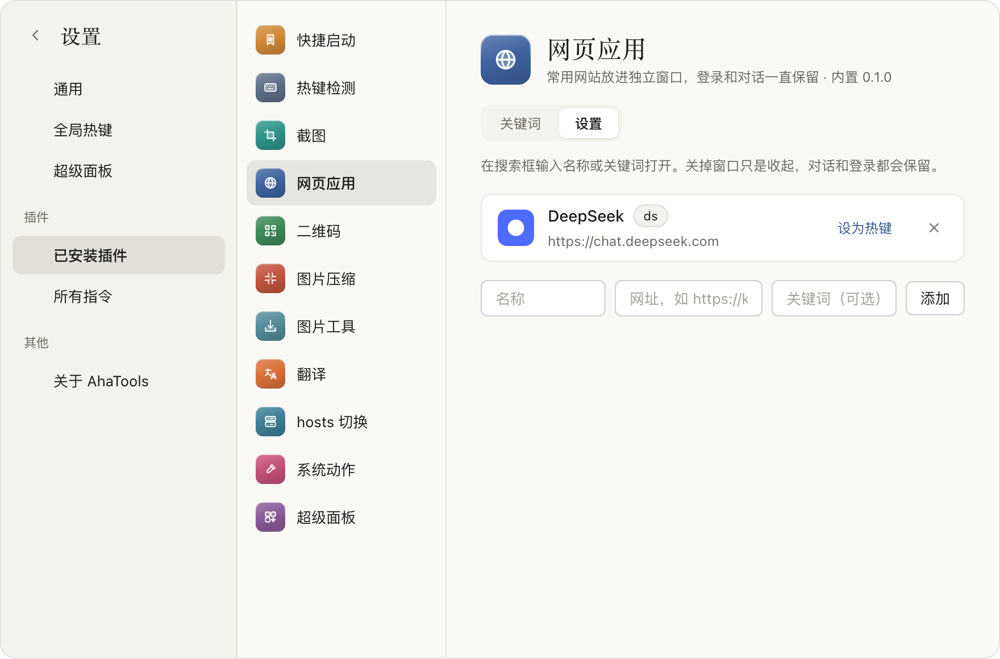
</td>
<td width="50%" valign="top">
<b>设置</b><br>
<sub>改动立即生效：热键、超级面板、插件的关键词和自动匹配、外观</sub><br><br>
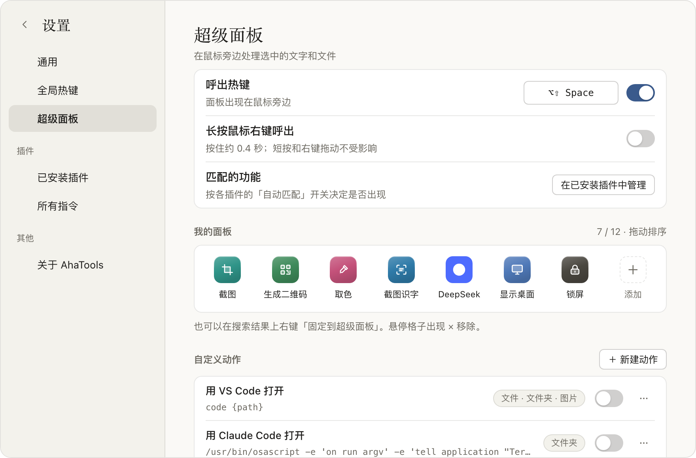
</td>
</tr>
</table>

另外还有：**截图**（一个热键调用系统截图、微信、QQ 或钉钉的截图工具）、**系统动作**（取色、显示桌面、锁屏）、**图片工具**（把粘贴的图片保存为 PNG 或复制）、**快捷启动**（收藏常用文件夹和路径）。

## 安装

1. 在 [Releases](https://github.com/PYPARA/Aha-tools/releases/latest) 下载 `AhaTools-<版本>-arm64.zip`，解压后把 `AhaTools.app` 拖进「应用程序」。
2. 第一次打开：应用使用自签名证书，没有经过苹果公证，macOS 会提示无法验证开发者。关掉提示后到「系统设置 → 隐私与安全性」，在页面底部点「仍要打开」；或者在终端运行：

   ```bash
   xattr -dr com.apple.quarantine /Applications/AhaTools.app
   ```

3. 按提示授权（都可以之后在「系统设置 → 隐私与安全性」里改）：

   | 权限 | 用途 |
   | --- | --- |
   | 辅助功能 | 独占热键、读取选中的文字、长按右键呼出超级面板 |
   | 自动化 · 访达 | 超级面板读取访达里选中的项目 |
   | 屏幕录制 | 截图识字 |

4. 在菜单栏弹出面板里打开「开机自动启动」。

> 目前只提供 Apple Silicon 版本。数据保存在 `~/Library/Application Support/com.ahatools.app/`，删除这个文件夹即可清空所有设置。

## 隐私

- 不收集任何使用数据，没有统计和自动上报。
- 搜索、截图识字、图片压缩、二维码都在本机完成。
- 只有你主动使用时才会联网：翻译把文字发给**你自己配置**的服务；网页应用打开对应网站。
- 翻译服务的 API Key 只保存在本机数据目录，不会显示在界面上。

## 从源码构建

需要 macOS、[Rust](https://rustup.rs)、[Bun](https://bun.sh) 和 Xcode 命令行工具。

```bash
bun install
bun run tauri dev
```

开发时用浏览器打开 <http://localhost:1420> 可以直接预览界面，数据来自 `src/dev-mock.ts`，不会调用系统功能。

运行测试：

```bash
bun test
```

```bash
cd src-tauri && cargo test
```

打包正式版：

```bash
bun run release
```

脚本会打包 `AhaTools.app`，用本机生成的自签名证书签名（第一次运行时生成，之后复用，所以更新后系统授权不会失效），并输出用于发布的 zip：`src-tauri/target/release/bundle/AhaTools-<版本>-<架构>.zip`。

## 项目结构

```
src-tauri/src/        Rust：窗口、热键、菜单栏、上下文读取、插件的原生部分
src/                  React：搜索面板、超级面板、菜单栏弹窗，插件 SDK（@ahatools/sdk）
plugins/<id>/         每个内置插件：plugin.json 清单和页面
docs/                 接手说明、实现规格、设计规范和设计稿
```

### 写一个插件

1. 新建 `plugins/<id>/plugin.json`，每个功能的 `cmds` 是搜索关键词，`match` 声明能自动处理的文字、图片或文件。
2. 为每个功能写一个页面 `plugins/<id>/<View>.tsx`，只从 `@ahatools/sdk` 引入宿主能力。
3. 在 `src/views.ts` 里登记为 `"<id>/<功能 code>"`，并把清单加入 `src-tauri/src/plugins/mod.rs` 的 `BUILTIN_MANIFESTS`。
4. 需要原生代码时加 `src-tauri/src/plugins/<id>.rs`，在 `lib.rs` 注册命令。

声明了 `match` 的功能会自动出现在搜索面板的粘贴 / 拖入联想和超级面板里，不需要额外接入。更多细节见 [docs/HANDOFF.md](docs/HANDOFF.md) 和 [docs/specs.md](docs/specs.md)。

## 许可证

[MIT](LICENSE) © 2026 PYPARA
