<div align="center">


# AhaTools

轻量的 macOS 菜单栏工具箱：一个热键搜索一切，鼠标旁边处理选中的文字和文件，菜单栏看网速和系统状态。

[](https://github.com/PYPARA/Aha-tools/releases/latest)


[](LICENSE)

</div>

当前源码版本：**0.2.0**。下载包以 [Releases](https://github.com/PYPARA/Aha-tools/releases/latest) 中已发布的版本为准。

<p align="center">
  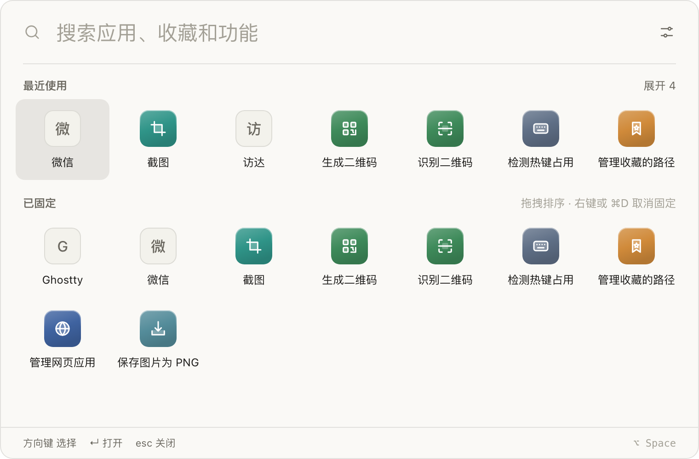
</p>

## 0.2.0 更新

- **统一右键菜单**：首页、搜索、收藏管理和超级面板保留同一对象的常用操作，文件可直接定位或复制路径；支持 Control 点按、Shift+F10、方向键和 Esc。文字输出可复制选区或全部内容，输入框保留系统编辑菜单。
- **收藏可编辑**：修改名称、文件路径或网址，可为每条本地收藏选择打开应用；支持仅本次使用或记为默认。已有搜索、最近使用与固定入口同步更新，旧收藏自动迁移。
- **剪贴板更方便**：图片文件能直接预览，区分复制文件和复制图片；完整图片可保存副本，多文件可逐个查看和定位。单条删除提供 **10 秒撤销**，暂停记录后仍能使用已有历史。
- **网页应用可编辑**：修改名称、网址和关键词，保留快捷键与固定关系；共用 Dock 入口，原生标题栏支持刷新。修改网址后当前页面与对话继续保留，下次重启 AhaTools 使用新首页。
- **工具页补齐操作**：进程支持复制 PID 与路径；端口可精确跳到对应进程，手动选择 HTTP 或 HTTPS 打开；压缩支持单张导出与失败项重新读取重试；hosts 方案可通过右键管理草稿。
- **面板管理更顺手**：超级面板固定项支持拖动排序和搜索添加；菜单栏右键可直接打开搜索、设置或退出。

<p align="center">
  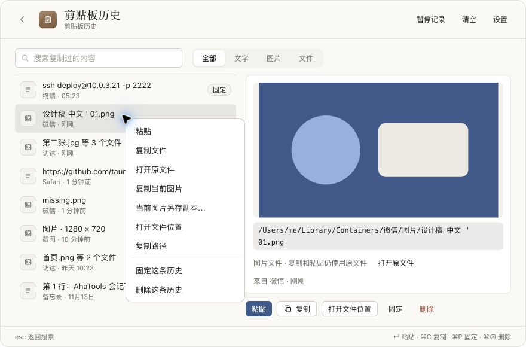
</p>

截图为使用假数据的界面预览；系统权限和原生交互的验收状态见 [验收记录](docs/verification/context-menus-2026-11-16.md)。

## 功能

**搜索面板（默认 ⌥Space）**

- 搜应用、收藏的文件夹和路径、所有插件功能；支持中文名、全拼和首字母（`wx` → 微信）
- 记住你的选择：用 `chr` 选过 Chrome，下次它排第一；名称开头和词首命中优先
- 复制后马上打开面板，复制的文字、图片或文件直接作为输入（密码管理器的内容不会带入）
- 认得网址、JSON、IP、域名、端口、路径，适用的功能排在最前：粘贴 JSON → 格式化，输入域名 → ping；输入 `ip` 直接显示本机地址
- 首页显示最近使用和已固定，⌘1–9 直接打开，拖动排序；右键打开、定位、复制路径或管理固定项，插件功能可直接设置快捷键
- 输入 `fy hello` 这类「关键词 + 文字」直接带入功能；粘贴图片、拖入文件会自动列出能处理它的功能；搜不到时可直接在网上搜索或问网页应用
- 跟随鼠标所在的屏幕弹出；可设置再次打开时回到上次的页面还是搜索

**超级面板（默认 ⌥⇧Space，也可长按鼠标右键）**

<p>
  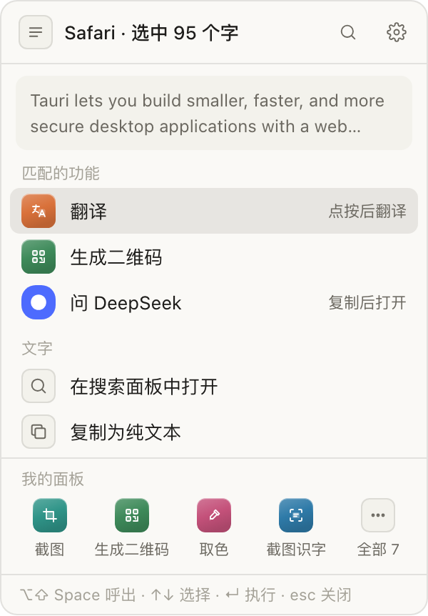
  &nbsp;
  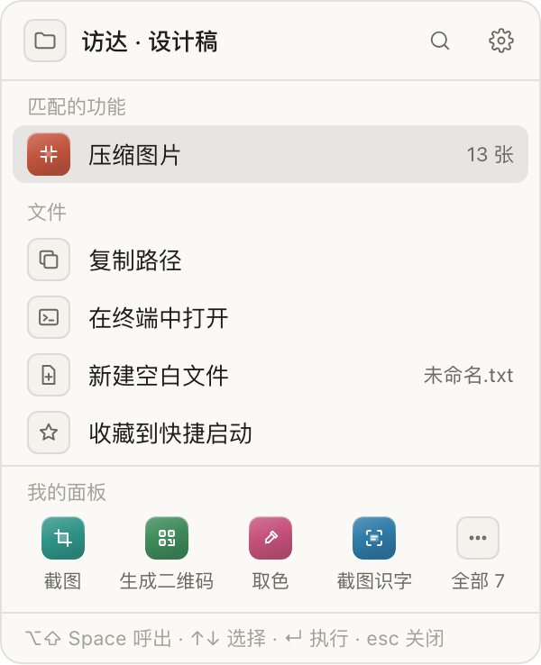
</p>

- 在鼠标旁边弹出，读取当前选中的文字，或访达里选中的文件 / 文件夹
- 按各插件声明的匹配规则列出能用的功能：文字 → 翻译、生成二维码、问网页应用；图片文件夹 → 压缩图片；单张图片 → 识别二维码
- 自带复制路径、在终端中打开、新建文件、收藏等操作，也能加自己的命令（如 `code {path}`）
- 什么都没选时显示「我的面板」：在搜索结果上右键「固定到超级面板」，或在「设置 → 超级面板」搜索添加；固定项可拖动排序，右键保留文件、网址或插件的常用操作
- 不会自动翻译，点了才发请求

**菜单栏**

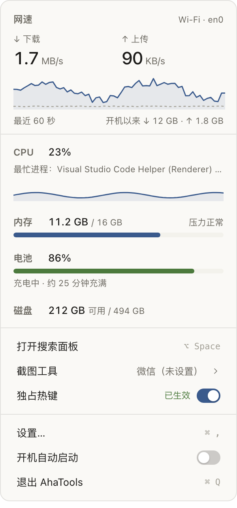

- 双行显示实时上传 / 下载网速，可加 CPU、内存
- 点开是网速曲线、CPU、内存、电池和磁盘
- 快速切换截图工具、独占热键和开机启动
- 左键打开监控弹窗；右键打开搜索面板、设置或退出 AhaTools

<br clear="right">

**内置插件**

<table>
<tr>
<td width="50%" valign="top">
<b>翻译</b><br>
<sub>接自己的大模型服务（OpenAI Chat / Responses、Anthropic Messages），流式翻译、润色、解释；单个单词给出音标、释义和例句</sub><br><br>
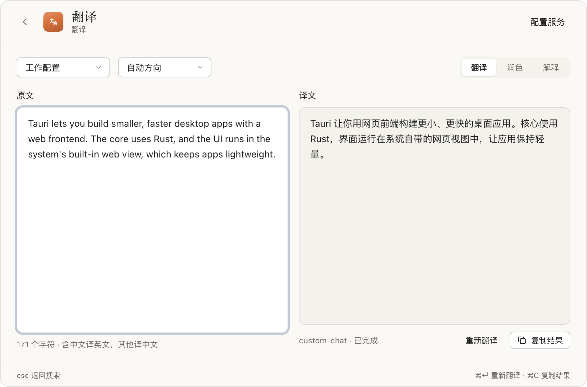
</td>
<td width="50%" valign="top">
<b>二维码</b><br>
<sub>边输入边生成，复制图片或保存 PNG；识别剪贴板、拖入图片里的二维码</sub><br><br>
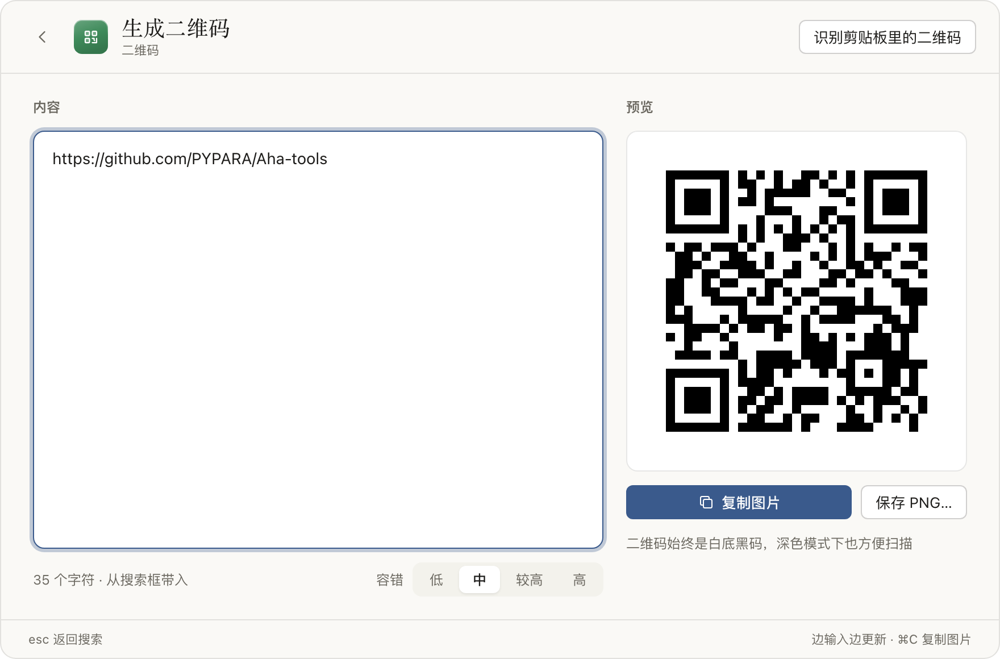
</td>
</tr>
<tr>
<td width="50%" valign="top">
<b>图片压缩</b><br>
<sub>PNG / JPEG / WebP 在本机批量压缩，结果先放临时目录；按批次或单张复制、另存和覆盖，失败项可重新读取重试</sub><br><br>
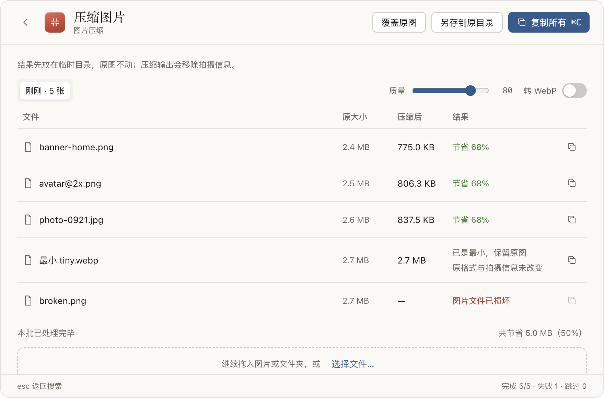
</td>
<td width="50%" valign="top">
<b>截图识字</b><br>
<sub>框选屏幕区域，用系统 Vision 在本机识别中英文，结果自动复制</sub><br><br>
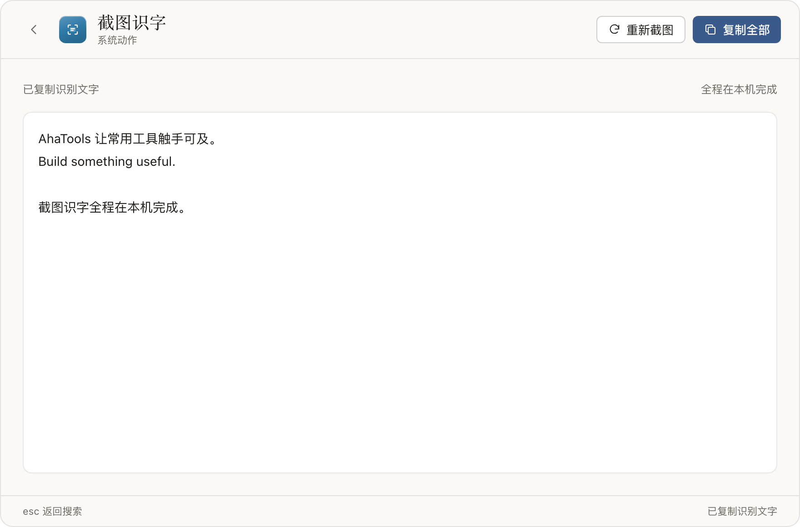
</td>
</tr>
<tr>
<td width="50%" valign="top">
<b>hosts 切换</b><br>
<sub>多套方案合并写入，右键管理名称、复制方案和下次启用状态；点击「应用」并授权后才修改系统，可恢复原始 hosts</sub><br><br>
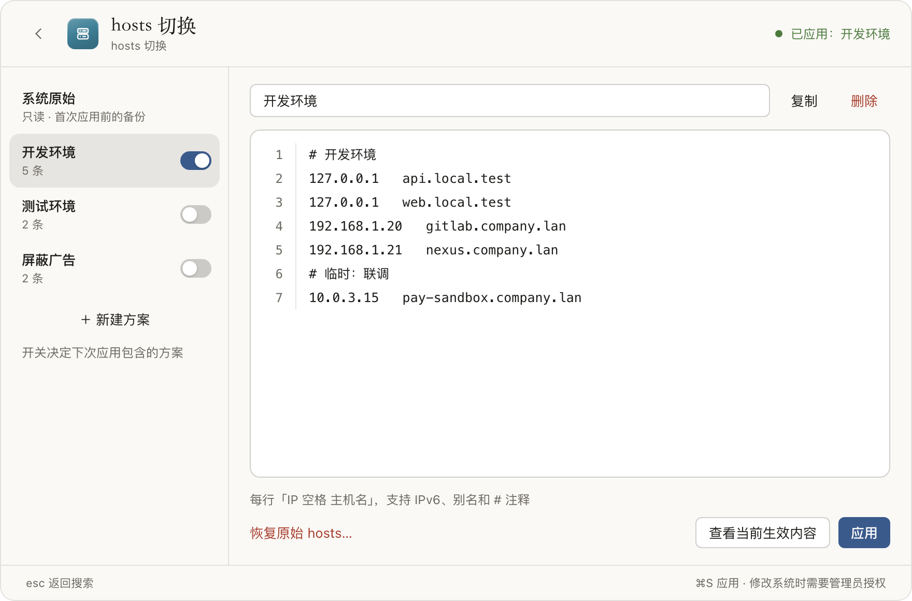
</td>
<td width="50%" valign="top">
<b>热键检测</b><br>
<sub>查看常用组合键被谁占用；独占热键让 uTools 等不再同时弹出</sub><br><br>
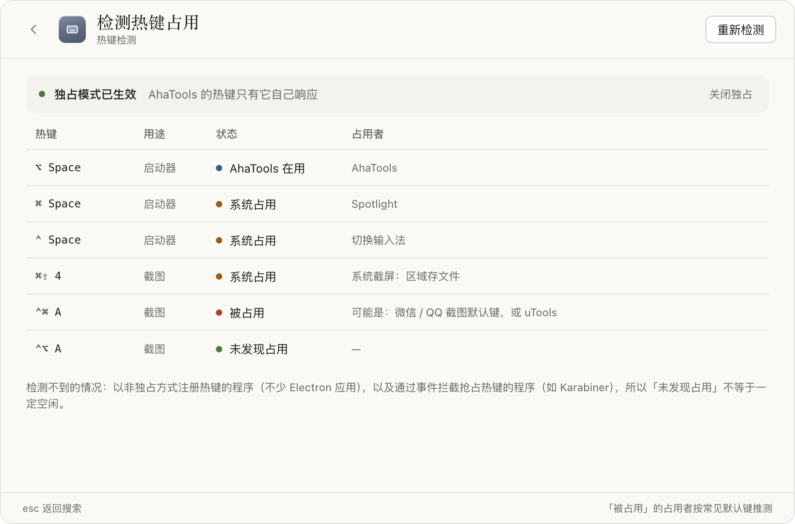
</td>
</tr>
<tr>
<td width="50%" valign="top">
<b>网页应用</b><br>
<sub>把常用网站放进独立窗口，收起后保留登录和对话，共用 Dock 入口；支持原生刷新、编辑与独立热键（内置 DeepSeek）</sub><br><br>
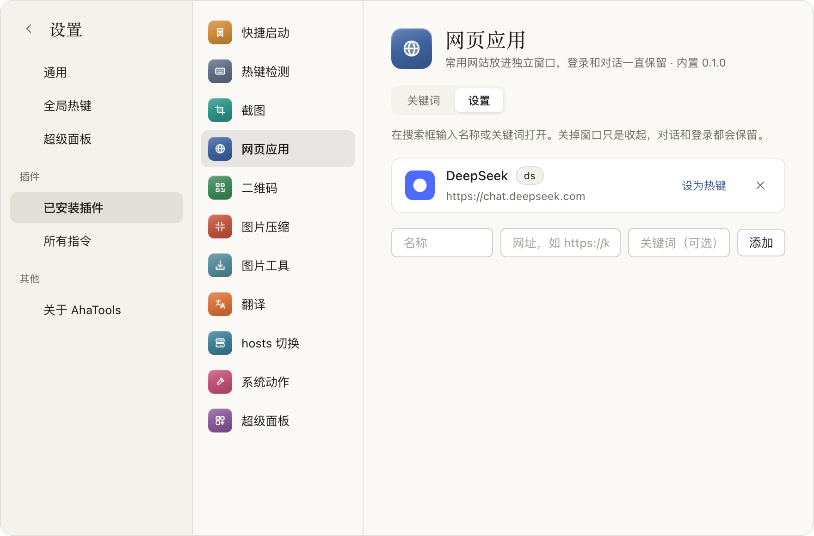
</td>
<td width="50%" valign="top">
<b>设置</b><br>
<sub>改动立即生效：热键、超级面板、插件的关键词和自动匹配、外观</sub><br><br>
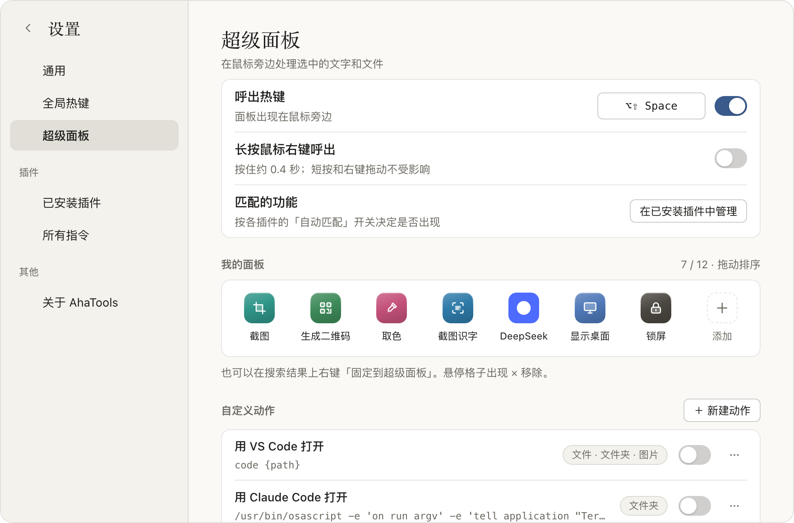
</td>
</tr>
</table>

另外还有：

- **进程管理**：按应用汇总 CPU 和内存，右键复制 PID、定位应用或可执行文件，退出或确认后强制结束；操作前校验进程身份
- **网络工具**：本机 / 公网 IP、ping、DNS 查询（对比 hosts 与本机解析）、端口占用；端口可复制地址与 PID、定位对应进程，并手动选择 HTTP / HTTPS 打开
- **JSON 工具**：格式化、压缩、转义、树形查看，出错时指出第几行第几列
- **剪贴板历史**：默认关闭；开启后保存文字、图片和文件，搜索后再次粘贴，支持图片文件预览、文件定位和完整图片保存；单条删除可在 10 秒内撤销，暂停时仍能使用历史
- **快捷启动**：收藏文件、文件夹和网址，支持改名、修改路径、指定打开应用和临时选择打开方式；网址使用默认浏览器，文件按系统关联或指定应用打开
- **截图**（一个热键调用系统截图、微信、QQ 或钉钉的截图工具）、**系统动作**（取色、显示桌面、锁屏）、**图片工具**（把粘贴的图片保存为 PNG 或复制）

## 常用快捷键

| 快捷键 | 操作范围与行为 |
| --- | --- |
| ⌥Space | 打开搜索面板，可在设置中修改 |
| ⌥⇧Space | 打开超级面板，可在设置中修改；长按右键需另行开启 |
| ⌘1–9 | 搜索结果中直接打开对应项 |
| Shift+F10 / Control 点按 | 为当前对象打开右键菜单；输入区域使用系统编辑菜单 |
| ↑ / ↓、Home / End、↵、Esc | 菜单内选择、跳到首尾、执行和关闭；关闭后回到原对象 |
| ⌘C / ⌘P / ⌘⌫ | 剪贴板历史中复制、固定和删除当前记录 |

## 安装

1. 在 [Releases](https://github.com/PYPARA/Aha-tools/releases/latest) 下载 `AhaTools-<版本>-arm64.zip`，解压后把 `AhaTools.app` 拖进「应用程序」。
2. 第一次打开：应用使用自签名证书，没有经过苹果公证，macOS 会提示无法验证开发者。关掉提示后到「系统设置 → 隐私与安全性」，在页面底部点「仍要打开」；或者在终端运行：

   ```bash
   xattr -dr com.apple.quarantine /Applications/AhaTools.app
   ```

3. 按提示授权（都可以之后在「系统设置 → 隐私与安全性」里改）：

   | 权限 | 用途 |
   | --- | --- |
   | 辅助功能 | 独占热键、读取选中的文字、长按右键呼出超级面板 |
   | 自动化 · 访达 | 超级面板读取访达里选中的项目 |
   | 屏幕录制 | 截图识字 |

4. 在菜单栏弹出面板里打开「开机自动启动」。

更新已有安装时，先退出 AhaTools，再替换「应用程序」中的同名应用并重新打开。收藏、快捷键等设置沿用原数据；同机使用相同签名证书构建可保持签名身份，证书更换后可能需要重新授权。

> 目前只提供 Apple Silicon 版本。数据保存在 `~/Library/Application Support/com.ahatools.app/`，删除这个文件夹即可清空所有设置。

## 隐私

- 不收集任何使用数据，没有统计和自动上报。
- 搜索、截图识字、图片压缩、二维码都在本机完成。
- 联网功能包括翻译请求、网页应用及网站图标加载、主动发起的 ping / DNS / 公网 IP 查询。翻译内容发给**你自己配置**的服务；公网 IP 查询使用设置中的服务（默认 api.ipify.org）。
- 翻译服务的 API Key 只保存在本机数据目录，不会显示在界面上。
- 「带入刚复制的内容」只在打开面板时读取剪贴板，不保存；剪贴板历史默认关闭，开启后明文保存在本机数据目录（仅你的账户可读），跳过密码管理器及带隐私标记的内容。
- 删除历史中的文件记录只删除历史信息，图片缓存按引用清理，来源文件始终保留；暂停记录只影响新内容。

## 从源码构建

需要 macOS、[Rust](https://rustup.rs)、[Bun](https://bun.sh) 和 Xcode 命令行工具。

```bash
bun install
bun run tauri dev
```

开发时用浏览器打开 <http://localhost:1420> 可以直接预览界面，数据来自 `src/dev-mock.ts`，不会调用系统功能。

运行测试：

```bash
bun test
```

```bash
cd src-tauri && cargo test
```

构建生产前端：

```bash
bun run build
```

本地打包与签名：

```bash
bun run release
```

脚本会打包 `AhaTools.app`，用本机固定的自签名证书签名（第一次运行时生成，之后复用），并输出 ZIP：`src-tauri/target/release/bundle/AhaTools-<版本>-<架构>.zip`。打包完成后可在 `src-tauri/target/release/bundle/macos/` 找到应用。此命令只生成本地产物，不会上传 Release 或自动替换已安装应用。

应用版本由 `package.json`、`src-tauri/Cargo.toml` 和 `src-tauri/tauri.conf.json` 同步维护；浏览器开发预览从 `package.json` 读取版本。内置插件清单的版本独立维护。

## 项目结构

```
src-tauri/src/        Rust：窗口、热键、菜单栏、上下文读取、插件的原生部分
src/                  React：搜索面板、超级面板、菜单栏弹窗，插件 SDK（@ahatools/sdk）
plugins/<id>/         每个内置插件：plugin.json 清单和页面
docs/                 接手说明、实现规格、设计规范和设计稿
```

### 写一个插件

1. 新建 `plugins/<id>/plugin.json`，每个功能的 `cmds` 是搜索关键词，`match` 声明能自动处理的文字、图片或文件。
2. 为每个功能写一个页面 `plugins/<id>/<View>.tsx`，只从 `@ahatools/sdk` 引入宿主能力。
3. 在 `src/views.ts` 里登记为 `"<id>/<功能 code>"`，并把清单加入 `src-tauri/src/plugins/mod.rs` 的 `BUILTIN_MANIFESTS`。
4. 需要原生代码时加 `src-tauri/src/plugins/<id>.rs`，在 `lib.rs` 注册命令。

声明了 `match` 的功能会自动出现在搜索面板的粘贴 / 拖入联想和超级面板里，不需要额外接入。更多细节见 [docs/HANDOFF.md](docs/HANDOFF.md) 和 [docs/specs.md](docs/specs.md)。

## 许可证

[MIT](LICENSE) © 2026 PYPARA
